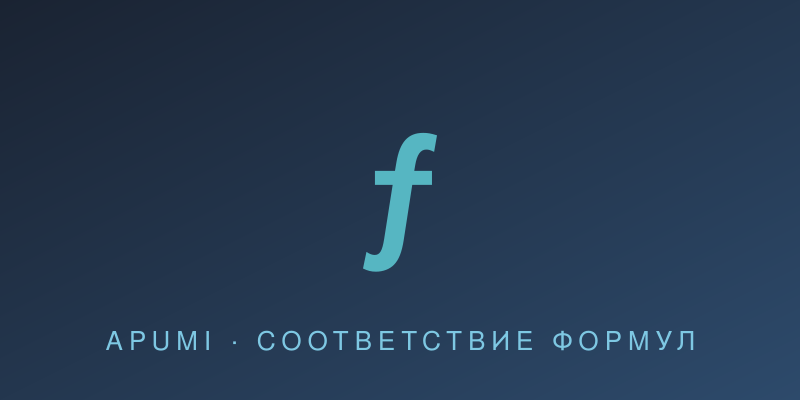

# Formula Conformance Checker

**57 формул, 76 векторов, 25 инвариантов. SARIF 2.1.0. Model risk management.**

---

## За 30 секунд

**Что это:** FCC — 57 формул, 76 векторов, 25 инвариантов. SARIF 2.1.0. Manifest conformance.json.

**Кому:** Банки, страховые — SR 11-7 / SOX / model risk.

**Почему сейчас:** Model risk management требует проверки формул. FCC проверяет формулы против QuantLib — 19/19 совпали.

**Что доказано:** 12 passed. QuantLib 1.44: 19/19 совпали. apumia prove → PROVEN.

**Чего не доказано (честно):** CI на GitHub не запускался. QuantLib покрытие 19/25 (6 не дописаны — честно).

---

## Оффер

Интеграция 300–500K ₽.

**Следующий шаг:** Покажу QuantLib 19/19 вживую — 20 минут.

---

## GitHub

- **Private code:** apumiaaifund/formula-conformance-checker
- **Public demo:** apumiaaifund/formula-conformance-checker-demo

## License

MIT

---

### 🚀 Что мы можем реализовать для партнёров на основе этого решения (Ниши и сценарии)

- **Корпоративный ИИ и Финтех:** интеграция детерминированного контроля, крипто-аудита и верификации данных в контур заказчика.
- **Промышленность и ИБ:** адаптация модулей под закрытые контуры (On-Premise) с соблюдением требований безопасности.

> **Формат сотрудничества:** запуск пилотного стенда (PoC) за 2–4 недели, лицензирование модуля (On-Premise) или кастомная интеграция под стек заказчика.  
> 📬 **Запросить демонстрацию и расчёт пилота:** [apumiaaifund@gmail.com](mailto:apumiaaifund@gmail.com)

---

### 🛡️ Верификация качества и безопасности (Apumia DevSecOps Gate)

> **Статус:** `VERIFIED & PROVEN` • **Дата аудита:** `16.11.2026`  
> **Контроль архитектуры (`Apumia Blueprint`):** `CLEAN` (`0` циклических зависимостей, контроль сложности McCabe)  
> **Анализ безопасности (`Bandit / Zero-Trust`):** `0` критических уязвимостей  
> **Протокол достоверности (`Apumia Hub`):** `_synthetic: false` | `preservation: 100.0%` | `verified: true`

## Commercial Source Code & Private Repo Access
Instant read-only GitHub access: **[Buy Formula Conformance Checker ($149) ↗](https://lava.top1af5b507-3b89-4b1c-8a40-6bb32d45c2c4)**
